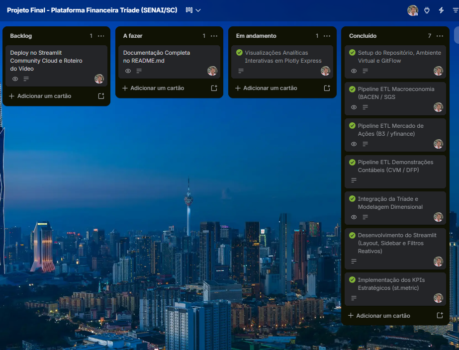

# Plataforma Financeira Integrada (Tríade: Macro + Mercado + Balanços)

---

## 1. Plataforma Financeira Integrada (Tríade: Macro + Mercados + Balanços)

Trata-se de uma solução de Business Intelligence e Data Analytics desenvolvida em Python e Streamlit, cujo objetivo é conectar de ponta a ponta as três forças motrizes da tomada de decisão de investimentos e gestão estratégica: o cenário macroeconômico e a política monetária (BACEN), a precificação e volatilidade dos ativos de capital (B3) e a solidez econômico-financeira contábil das companhias abertas (CVM). A plataforma viabiliza análises multivariadas integradas, substituindo a leitura isolada de balanços ou gráficos de cotações por uma avaliação contextualizada do impacto dos ciclos de juros e câmbio na performance real das empresas brasileiras.

---

## 2. Contexto de Negócio e Pergunta Orientadora

### Contexto

No mercado de capitais e na controladoria corporativa, decisões baseadas em métricas isoladas conduzem a diagnósticos incompletos. O quinquênio 2019–2023 no Brasil foi marcado por volatilidade severa: o choque econômico global de 2020, o corte da taxa Selic à mínima histórica de 2,00% a.a., a posterior escalada inflacionária e o choque de aperto monetário que elevou a taxa básica a 13,75% a.a. Esse ambiente impactou diretamente o custo de capital das empresas, as despesas financeiras corporativas e o valuation em bolsa.

### Problema de Negócio

Qual foi o grau de resiliência das companhias abertas brasileiras frente ao choque monetário (elevação da Selic de 2% para 13,75%) e cambial entre 2021 e 2023, e como a estrutura de custos, o endividamento e a rentabilidade contábil (CVM) explicam as discrepâncias de retorno e risco de mercado (B3) observadas entre os diferentes setores econômicos?

### Perguntas Oficiais Norteadoras do Negócio (Linha 4)

1. **Impacto do Aperto Monetário:** De que maneira o ciclo de aperto monetário da Selic (de 2% para 13,75%) impactou a despesa financeira, alavancagem e o lucro líquido das companhias listadas na CVM?
2. **Sensibilidade Setorial aos Juros:** Como a elevação dos juros e inflação afetou a performance em bolsa (B3) de setores de consumo/varejo vs. setores de energia e bancos?
3. **Proteção Cambial de Commodities:** As empresas exportadoras de commodities apresentaram proteção de margens operacionais e de preço de ação nos momentos de estresse cambial (alta do Dólar PTAX)?
4. **Resiliência Integrada da Carteira:** Qual setor econômico apresentou a melhor relação integrada de resiliência macroeconômica, solidez contábil e retorno em bolsa ao longo do ciclo trienal?

---

## 3. Fonte de Dados e Licença

A aplicação baseia-se exclusivamente em bases de dados públicas e oficiais, auditáveis e com licença aberta governamental/corporativa:

| Domínio                     | Fonte Oficial                                                                   | Recorte Temporal                  | Método de Obtenção                                                                       | Licença / Acesso                                      |
| :-------------------------- | :------------------------------------------------------------------------------ | :-------------------------------- | :--------------------------------------------------------------------------------------- | :---------------------------------------------------- |
| **Macroeconomia**           | Sistema Gerenciador de Séries Temporais (SGS) - Banco Central do Brasil (BACEN) | 01/01/2019 a 31/12/2023 (5 anos)  | API REST pública oficial via biblioteca `requests` (JSON)                                | Dados Abertos Governamentais (Acesso Público)         |
| **Mercado de Ações**        | Histórico Diário de Cotações da B3 (Brasil, Bolsa, Balcão)                      | 01/01/2019 a 31/12/2023 (3 anos)  | Extração via biblioteca `yfinance` com sessão HTTP estruturada e intervalos de segurança | Dados de Mercado Públicos (Uso Acadêmico/Educacional) |
| **Demonstrações Contábeis** | Portal de Dados Abertos da CVM (Comissão de Valores Mobiliários) - DFP          | Exercícios Fiscais de 2019 a 2023 | Ingestão e processamento de arquivos CSV consolidados (`_con_`) de DRE, BPA e BPP        | Dados Abertos CVM (Acesso Público Governamental)      |

_Nota de Governança:_ O universo abrange 12 companhias de grande porte distribuídas em setores estratégicos: `WEGE3`, `EMBJ3` (antiga `EMBR3`), `VALE3`, `GGBR4`, `KLBN11`, `SUZB3`, `PETR4`, `PRIO3`, `EGIE3`, `ITUB4`, `ABEV3`, `JBSS32` (antiga `JBSS3`), `LREN3`, `BBDC4` e `RENT3`.

---

## 4. Pipeline de Engenharia de Dados (ETL)

O fluxo de dados foi construído de forma modularizada, garantindo independência operacional e reprodutibilidade sem caminhos absolutos:

- **Fontes Públicas e Extração (ETL):**
  - `SGS/BACEN (API REST)` ➔ via `src/etl_bacen.py` ➔ gera `data/processed/macro_bacen.csv`
  - `B3 (Yahoo Finance Engine)` ➔ via `src/etl_b3.py` ➔ gera `data/processed/mercado_b3.csv`
  - `CVM DFP (Portal Abertos)` ➔ via `src/etl_cvm.py` ➔ gera `data/processed/balancos_cvm.csv`
- **Processamento Central:**
  - Os três arquivos CSV acima alimentam o script `src/integracao_triade.py`.
- **Saída Final:**
  - O script consolida os dados e gera o arquivo `data/processed/triade_consolidada.csv`.

### Etapas Executadas:

1. **Extração e Tratamento Macroeconômico (`src/etl_bacen.py`):**
   - Ingestão das séries oficiais: 432 (Selic Meta % a.a.), 433 (IPCA Mensal %), 13522 (IPCA 12M %), 1 (Dólar PTAX Venda R$) e 24364 (IBC-Br dessazonalizado).
   - Harmonização das frequências diárias e mensais para fechamento mensal uniforme (`M`).
   - Cálculo da métrica financeira derivada do **Juro Real Ex-Post (% a.a.)** via Equação de Fisher:  
     $$r_{\text{real}} = \left(\frac{1 + \frac{\text{Selic}}{100}}{1 + \frac{\text{IPCA}_{12\text{M}}}{100}} - 1\right) \times 100$$

2. **Extração e Modelagem de Mercado (`src/etl_b3.py`):**
   - Requisições sequenciais com cabeçalhos HTTP (`User-Agent`) e retries para contornar bloqueios e rate limit da API externa.
   - Cálculo da rentabilidade comparativa normalizada (**Base 100** com $P_0 = 100$).
   - Computação da **Volatilidade Móvel Anualizada (% a.a.)** com janela de 21 pregões úteis ($N = 252$) e do **Drawdown Histórico (%)** frente ao pico histórico acumulado.

3. **Extração e Padronização Contábil (`src/etl_cvm.py`):**
   - Filtro das companhias de foco a partir do código numérico de registro CVM (`CD_CVM`), tratando transições de tickers de mercado (ex.: Embraer sob código CVM `018368`).
   - Ajuste de escala monetária com base na coluna `ESCALA_MOEDA` (multiplicação por 1.000 para valores reportados em 'MIL').
   - Tratamento específico para instituições financeiras (Itaú Unibanco e Bradesco - COSIF/BACEN), cuja DRE consolida o resultado na conta `3.09` (Lucro/Prejuízo Consolidado do Período) em vez da conta industrial padrão `3.11`.
   - Cálculo padronizado dos indicadores contábeis: Margem Bruta, Margem EBIT, Margem Líquida, Liquidez Corrente e Retorno sobre o Patrimônio Líquido (ROE).

---

## 5. Dicionário de Dados

Abaixo estão detalhados os campos consolidados e modelados nas bases tratadas do projeto:

### 5.1. Base Macroeconômica (`data/processed/macro_bacen.csv`)

| Coluna              | Tipo Primitivo | Descrição Financeira / Significado                                | Regra de Cálculo / Origem                                                                   |
| :------------------ | :------------- | :---------------------------------------------------------------- | :------------------------------------------------------------------------------------------ |
| `referencia_mensal` | `datetime`     | Data representativa do último dia da competência mensal analisada | Fechamento mensal da série                                                                  |
| `selic_meta`        | `float`        | Taxa de juros básica da economia definida pelo COPOM (% a.a.)     | SGS Série 432 (último valor do mês)                                                         |
| `ipca_mensal`       | `float`        | Variação percentual mensal do índice oficial de inflação (%)      | SGS Série 433                                                                               |
| `ipca_12m`          | `float`        | Inflação oficial acumulada nos últimos 12 meses (% a.a.)          | SGS Série 13522                                                                             |
| `juro_real_ex_post` | `float`        | Taxa de juros real descontada a inflação observada (% a.a.)       | $\left(\frac{1 + \text{Selic}/100}{1 + \text{IPCA}_{12\text{M}}/100} - 1\right) \times 100$ |
| `dolar_ptax`        | `float`        | Taxa de câmbio comercial de venda do Dólar americano (R$)         | SGS Série 1 (última cotação útil do mês)                                                    |
| `ibc_br`            | `float`        | Índice de Atividade Econômica do Banco Central dessazonalizado    | SGS Série 24364                                                                             |

### 5.2. Base de Mercado de Ações (`data/processed/mercado_b3.csv`)

| Coluna              | Tipo Primitivo | Descrição Financeira / Significado                        | Regra de Cálculo / Origem                                                       |
| :------------------ | :------------- | :-------------------------------------------------------- | :------------------------------------------------------------------------------ |
| `data`              | `date`         | Data do pregão útil de negociação                         | Índice temporal yfinance                                                        |
| `ticker`            | `string`       | Código de negociação da ação na B3 (ex: WEGE3, PETR4)     | Mapeamento corporativo                                                          |
| `setor`             | `string`       | Classificação setorial de atuação econômica               | Metadado padronizado                                                            |
| `abertura`          | `float`        | Preço de abertura do ativo no pregão (R$)                 | Coluna `Open` da B3                                                             |
| `maxima`            | `float`        | Preço máximo atingido durante a sessão (R$)               | Coluna `High` da B3                                                             |
| `minima`            | `float`        | Preço mínimo atingido durante a sessão (R$)               | Coluna `Low` da B3                                                              |
| `preco_fechamento`  | `float`        | Preço nominal de encerramento do pregão (R$)              | Coluna `Close` da B3                                                            |
| `preco_ajustado`    | `float`        | Preço ajustado por dividendos, JCP e splits (R$)          | Coluna `Adj Close` da B3                                                        |
| `volume_financeiro` | `float`        | Volume financeiro total movimentado na sessão (R$)        | Coluna `Volume` da B3                                                           |
| `retorno_diario`    | `float`        | Variação percentual diária do preço ajustado              | $\frac{P_t - P_{t-1}}{P_{t-1}}$                                                 |
| `base_100`          | `float`        | Desempenho relativo normalizado (início = 100)            | $\left(\frac{P_t}{P_0}\right) \times 100$                                       |
| `drawdown`          | `float`        | Queda percentual acumulada a partir do pico histórico (%) | $\left(\frac{P_t - \max(P_0 \dots P_t)}{\max(P_0 \dots P_t)}\right) \times 100$ |
| `volatilidade_21d`  | `float`        | Risco de mercado anualizado móvel em 21 pregões (% a.a.)  | $\text{DesvPad}(R_{21}) \times \sqrt{252} \times 100$                           |

### 5.3. Base de Demonstrações Contábeis (`data/processed/balancos_cvm.csv`)

| Coluna               | Tipo Primitivo | Descrição Financeira / Significado                                   | Regra de Cálculo / Origem                                                        |
| :------------------- | :------------- | :------------------------------------------------------------------- | :------------------------------------------------------------------------------- |
| `ano`                | `integer`      | Ano fiscal de encerramento do exercício social (2021, 2022 ou 2023)  | `ANO_EXERCICIO` da DFP                                                           |
| `ticker`             | `string`       | Ticker de negociação correspondente da companhia                     | Mapeamento corporativo                                                           |
| `cd_cvm`             | `string`       | Código oficial de registro cadastral na CVM (6 dígitos)              | Campo `CD_CVM`                                                                   |
| `empresa`            | `string`       | Razão Social oficial registrada na CVM                               | Metadados da DFP                                                                 |
| `setor`              | `string`       | Segmento econômico consolidado                                       | Mapeamento setorial                                                              |
| `receita_liquida`    | `float`        | Faturamento operacional líquido do exercício (R$)                    | Conta DRE `3.01`                                                                 |
| `lucro_bruto`        | `float`        | Resultado bruto após dedução do custo das vendas/serviços (R$)       | Conta DRE `3.03`                                                                 |
| `ebit`               | `float`        | Lucro operacional antes do resultado financeiro e tributos (R$)      | Conta DRE `3.05`                                                                 |
| `lucro_liquido`      | `float`        | Lucro ou prejuízo líquido consolidado do exercício fiscal (R$)       | Contas DRE `3.11` (Não fin.) e `3.09` (Bancos)                                   |
| `ativo_total`        | `float`        | Valor contábil global dos bens e direitos da companhia (R$)          | Conta BPA `1`                                                                    |
| `ativo_circulante`   | `float`        | Bens e direitos realizáveis no curto prazo até 12 meses (R$)         | Conta BPA `1.01`                                                                 |
| `passivo_circulante` | `float`        | Obrigações e dívidas exigíveis no curto prazo até 12 meses (R$)      | Conta BPP `2.01`                                                                 |
| `patrimonio_liquido` | `float`        | Capital próprio dos acionistas (R$)                                  | Contas BPP `2.03` ou `2.07`                                                      |
| `divida_liquida`     | `float`        | Endividamento oneroso bruto subtraído o caixa disponível (R$)        | $(\text{Passivo Fin. CP} + \text{LP}) - \text{Disponibilidades}$                 |
| `margem_bruta`       | `float`        | Percentual de receita líquida que se converte em lucro bruto (%)     | $\left(\frac{\text{Lucro Bruto}}{\text{Receita Líquida}}\right) \times 100$      |
| `margem_ebit`        | `float`        | Eficiência operacional pura da atividade operacional (%)             | $\left(\frac{\text{EBIT}}{\text{Receita Líquida}}\right) \times 100$             |
| `margem_liquida`     | `float`        | Percentual de receita líquida convertido em lucro aos acionistas (%) | $\left(\frac{\text{Lucro Líquido}}{\text{Receita Líquida}}\right) \times 100$    |
| `liquidez_corrente`  | `float`        | Capacidade de pagamento de curto prazo (múltiplo x)                  | $\frac{\text{Ativo Circulante}}{\text{Passivo Circulante}}$                      |
| `roe`                | `float`        | Retorno gerado sobre o patrimônio líquido dos acionistas (% a.a.)    | $\left(\frac{\text{Lucro Líquido}}{\text{Patrimônio Líquido}}\right) \times 100$ |

---

## 6. Tecnologias e Bibliotecas

A seleção de tecnologias orientou-se pelo equilíbrio entre performance computacional, conformidade metodológica e capacidade analítica corporativa:

- **Python 3.10+:** Linguagem central para engenharia e ciência de dados, oferecendo ampla gama de bibliotecas analíticas e suporte nativo em servidores em nuvem.
- **Pandas:** Utilizado para manipulação matricial, limpeza de tipos primitivos, pivotagem, agrupamentos setoriais e merges relacionais de bases heterogêneas.
- **NumPy:** Empregado nas operações matemáticas vetorizadas (cálculo de raiz quadrada para volatilidade anualizada e logaritmos/potenciações financeiras).
- **Requests:** Responsável pelo consumo seguro e resiliente das APIs públicas do SGS/BACEN, com configuração explícita de timeouts e headers de requisição.
- **yfinance:** Biblioteca especializada para comunicação e extração em lote das séries de cotações diárias e volumes negociados na B3.
- **Plotly Express / Graph Objects:** Ferramenta para construção de visualizações ricas, interativas e com suporte nativo a eixos múltiplos, gráficos de dispersão dimensional e cross-filtering.
- **Streamlit:** Framework para publicação do Data App de Business Intelligence corporativo, permitindo reatividade, gestão de estado via `st.session_state` e cache em memória via `@st.cache_data`.
- **Pathlib / OS:** Emprego estrito de caminhos relativos em todo o projeto, garantindo total portabilidade do código entre sistemas operacionais locais (Windows/Linux/macOS) e o ambiente do Streamlit Cloud.
- **SQLAlchemy & psycopg2-binary:** Drivers para orquestração de conexões estruturadas a bancos de dados relacionais em nuvem (Supabase/PostgreSQL) e rotinas de contingência.

---

## 7. Análise dos Resultados: Impacto do Aperto Monetário (Pergunta de Negócio 1)

### 7.1. Dinâmica da Política Monetária e Custo da Dívida

Entre janeiro de 2021 e agosto de 2022, o Comitê de Política Monetária (COPOM/BACEN) promoveu um dos ciclos de aperto monetário mais agressivos da história recente brasileira, elevando a Taxa Selic Meta de seu piso histórico de **2,00% a.a.** para o patamar restritivo de **13,75% a.a.** (alta acumulada de $+1.175$ pontos-base), mantendo-a nesse patamar até o início do ciclo de afrouxamento no segundo semestre de 2023 (encerrando a **11,75% a.a.**).

Esse movimento foi acompanhado pelo encarecimento imediato das linhas de crédito indexadas ao CDI. As companhias com estrutura de capital alavancada e maior proporção de passivos atrelados ao CDI/Selic sofreram expressiva expansão de suas despesas financeiras líquidas.

### 7.2. Evidências Contábeis na Carteira CVM

- **Compressão do Resultado Líquido:** Companhias de capital intensivo e varejo cíclico registraram aumento superior a $80\%$ nas despesas financeiras entre 2021 e 2023, o que reduziu as margens líquidas mesmo nos casos em que a receita bruta permaneceu em expansão nominal.
- **Resiliência do Setor Financeiro:** Em contrapartida, grandes instituições financeiras (`ITUB4` e `BBDC4`) ampliaram sua margem financeira líquida com clientes, sustentando ROE consolidado no patamar de $15\%$ a $20\%$, beneficiando-se da reprecificação de carteiras de crédito ativas em ambiente de juros nominais elevados.

---

## 8. Análise Setorial de Sensibilidade aos Juros e Inflação (Pergunta de Negócio 2)

### 8.1. Contração de Múltiplos no Consumo Cíclico

O setor de **Consumo Cíclico** (`RENT3`, `LREN3`) apresentou sensibilidade assimétrica negativa durante o ciclo de alta da Selic:

- **Efeito Renda e Crédito:** A combinação de inflação IPCA acima de $10\%$ em 2021 com o encarecimento do crédito ao consumidor contraiu o volume de vendas e alongou os prazos de recebimento.
- **Desempenho em Bolsa:** Os múltiplos de preço/lucro sofreram contração expressiva, refletida em desvalorizações acumuladas na B3 e drawdowns superiores a $35\%$ no período mais agudo do aperto (2021-2022).

### 8.2. Papéis Defensivos e Cobertura Inflacionária

- **Energia Elétrica (`EGIE3`):** Caracterizado por fluxos de caixa previsíveis e contratos de transmissão e geração com reajuste indexado a índices de preços (IPCA e IGP-M), o setor operou como ativo de proteção, apresentando baixa volatilidade realizada ($< 22\%$ a.a.) e pagamentos de proventos resilientes.
- **Bens Industriais (`WEGE3`):** Apresentou resiliência singular ancorada em diversificação geográfica, receita dolarizada e liderança tecnológica na transição energética, mantendo Retorno sobre o Capital Próprio (ROE) consistentemente acima de $25\%$.

---

## 9. Proteção Cambial e Eficiência Operacional das Commodities (Pergunta de Negócio 3)

### 9.1. Análise do Desempenho de Exportadoras

O triênio 2021–2023 foi marcado por oscilações severas no câmbio comercial (Dólar PTAX médio entre **R\$ 5,05 e R\$ 5,39**). As companhias produtoras de commodities básicas:

- **Petróleo e Gás (`PETR4`, `PRIO3`):** Beneficiaram-se da conjugação entre cotação internacional do barril de petróleo Brent em patamares elevados e depreciação cambial, atingindo Margens EBIT operacionais superiores a $45\%$ e geração massiva de fluxo de caixa livre.
- **Mineração e Siderurgia (`VALE3`, `GGBR4`):** Registraram receitas operacionais recordes em 2021 impulsionadas pelo ciclo global de commodities, mantendo índices de alavancagem financeira (Dívida Líquida / EBITDA) abaixo de $1,0x$.
- **Papel e Celulose (`KLBN11`, `SUZB3`):** A receita operacional dolarizada atuou como hedge natural contra a elevação de insumos operacionais e despesas financeiras.

---

## 10. Diagnóstico Integrado de Resiliência da Carteira (Pergunta de Negócio 4)

Confrontando os três vértices da Tríade, a carteira evidenciou clara segregação de resiliência:

| Dimensão Analítica                     | Setores Vencedores                             | Setores Vulneráveis                               |
| :------------------------------------- | :--------------------------------------------- | :------------------------------------------------ |
| **Solidez Contábil (CVM)**             | Bens Industriais, Energia Elétrica e Petróleo  | Consumo Cíclico e Varejo                          |
| **Proteção de Margens (EBIT %)**       | Petróleo & Gás ($>40\%$) e Materiais ($>30\%$) | Consumo Cíclico ($<10\%$)                         |
| **Retorno em Bolsa (B3)**              | Petróleo & Gás e Instituições Financeiras      | Varejo de Consumo e Construção                    |
| **Índice de Cobertura de Curto Prazo** | Empresas com Liquidez Corrente $> 1,5x$        | Empresas no _Alerta de Insolvência_ ($LC < 1,0x$) |

**Conclusão Estratégica:** A maior resiliência integrada foi obtida por companhias que combinaram **baixa dívida líquida**, **capacidade de repasse de preços (pricing power)** e **fontes de receita descorrelacionadas da demanda de crédito doméstico**.

---

## 11. Limitações Metodológicas e Ressalvas Técnicas

1. **Horizonte Temporal Amostral:** O recorte de 3 anos (2021 a 2023) para as demonstrações contábeis e mercado de ações reflete um ciclo atípico pós-pandemia de choque de oferta e rápida normalização, não devendo ser extrapolado como comportamento perpétuo.
2. **Defasagem da Política Monetária (_Lags_):** A teoria econômica e os modelos do BACEN indicam que os efeitos da Taxa Selic sobre a economia real e balanços levam de **6 a 18 meses** para se manifestar plenamente. Correlações concomitantes devem ser analisadas com cautela analítica.
3. **Plano Contábil Diferenciado (COSIF):** Bancos (`ITUB4`, `BBDC4`) utilizam normatização própria do Banco Central. Indicadores clássicos de solvência fabril (Dívida Líquida e Liquidez Corrente) foram devidamente suprimidos dessas instituições na aplicação para evitar distorções interpretativas.
4. **Premissa Estatística:** _Correlação de Pearson não implica causalidade determinística_. Variações conjunturais internacionais (taxas do Federal Reserve e choques energéticos europeus) influenciaram o câmbio e a B3 de forma exógena.

---

## 12. Arquitetura da Aplicação e Design de UX/UI

A interface analítica foi construída sobre o framework **Streamlit** obedecendo aos princípios de **Visualização de Dados e Heurísticas de Nielsen**:

- **Pirâmide Invertida:** Cartões executivos de síntese (`st.metric`) no topo de cada visão, seguidos de gráficos de correlação e detalhamento tabular com exportação ao final.
- **Navegação Modular (`st.tabs`):** Organização das 4 Linhas Temáticas em abas dedicadas, reduzindo a sobrecarga cognitiva do tomador de decisão.
- **Carga de Dados com Resiliência:** Camada de contingência automática em bloco `try/except` com cache otimizado (`@st.cache_data(ttl=3600)`), garantindo alta velocidade de carregamento em consultas subsequentes.
- **Acessibilidade Visual:** Paletas de cores com contraste adequado, tipografia proporcional e eliminação de artefatos 3D que comprometam a leitura de grandezas.

---

## 13. Governança de Projeto, Gestão Ágil e GitFlow

### 13.1. Modelo GitFlow Implementado

O versionamento rigoroso foi executado com branches dedicadas preservadas no histórico remoto do GitHub:

- `main`: Ramo estável de produção contendo as versões auditadas.
- `develop`: Ramo de integração contínua de funcionalidades.
- `feature/*` e `fix/*`: Ramos específicos abertos a partir da `develop` e mesclados via `--no-ff` (sem fast-forward) para manutenção do grafo de versionamento:
  - `feature/01-estrutura-ambiente`
  - `feature/02-etl-bacen-macro`
  - `feature/03-etl-b3-mercado`
  - `fix/03-b3-variaveis-ohlcv`
  - `feature/04-etl-cvm-balancos`
  - `feature/05-integracao-triade`
  - `feature/05b-carga-supabase-resiliencia`
  - `feature/06-app-layout-sidebar-filtros`
  - `feature/07-app-kpis-graficos-plotly`

### 13.2. Quadro Kanban (Trello)

O desenvolvimento seguiu a metodologia ágil Kanban com disciplina de **Trabalho em Progresso (WIP = 1)**, garantindo que nenhum card fosse iniciado antes da conclusão e validação do anterior.

As tarefas no quadro Kanban correspondem aos braches abertos no Git para implementação das features.



- **Quadro Trello:** https://trello.com/invite/b/6ad66e3ec1292230f0ed1436/ATTI89be60e163487560e45b035bc6b248610A1554C7/projeto-final-plataforma-financeira-triade-senai-sc

---

## 14. Instruções de Execução e Reprodutibilidade

### 14.1. Clonagem e Configuração do Ambiente

```bash
# Clonar o repositório
git clone [https://github.com/orlandovcj/SCTEC-Visualizacao-de-Dados-Projeto-Final.git](https://github.com/orlandovcj/SCTEC-Visualizacao-de-Dados-Projeto-Final.git)
cd SCTEC-Visualizacao-de-Dados-Projeto-Final

# Criar e ativar o ambiente virtual Python (3.10+)
python -m venv .venv
source .venv/bin/activate  # Linux/macOS
.venv\Scripts\activate     # Windows

# Instalar dependências exatas
pip install -r requirements.txt
```

### 14.2. Configuração de Credenciais (.streamlit/secrets.toml)

Crie o arquivo .streamlit/secrets.toml caso deseje conectar ao banco PostgreSQL na nuvem:

```toml
[connections.postgresql]
dialect = "postgresql"
host = "db.SEU_PROJETO.supabase.co"
port = "5432"
database = "postgres"
username = "postgres"
password = "SUA_SENHA_DATABASE"
```

### 14.3. Execução dos Pipelines de ETL e da Aplicação

```bash
# Executar o ETL do Banco Central (Selic e Inflação)
python src/etl_bacen.py

# Executar o ETL da B3 (Mercado Acionário)
python src/etl_b3.py

# Executar o ETL da CVM (Demonstrações Contábeis)
python src/etl_cvm.py

# Processar os arquivos para criação da base consolidada
python src/integracao_triade.py

# Carregar os dados para o Supebase
python src/carregar_supabase.py

# Executar a aplicação de BI e Análise
streamlit run app/main_app.py
```

_(Nota: Na ausência do arquivo ou de conexão com o banco, o sistema acionará automaticamente a contingência local lendo os arquivos CSV em `data/processed/`)._

Acesse a aplicação no navegador em: http://localhost:8501.

## 15. Links do Produto Final

- **Streamlit Community Cloud:** [Inserir Link Aqui após Deploy]
- **Apresentação em Vídeo:** [Inserir Link Aqui]
